# React Deployment Platform

A self-hosted, Vercel-style platform for deploying Vite/React applications straight from GitHub. You sign in with GitHub and pick a repository. The platform checks that it is a Vite project, builds it in an isolated AWS Fargate container, streams the build logs live to your browser, publishes the output to S3 and serves it at `https://<slug>.<root-domain>`. A `git push` to the production branch redeploys automatically, and every page view is recorded and shown as analytics.

This document is the technical reference for backend engineers. It covers every service, worker, queue, lock, topic, table and route, and explains how they fit together.

---

## Table of contents

1. [Feature overview](#1-feature-overview)
2. [Technology stack](#2-technology-stack)
3. [Repository layout](#3-repository-layout)
4. [System architecture](#4-system-architecture)
5. [Services at a glance](#5-services-at-a-glance)
6. [API gateway](#6-api-gateway)
7. [Authentication and sessions](#7-authentication-and-sessions)
8. [Projects](#8-projects)
9. [Deployment lifecycle](#9-deployment-lifecycle)
10. [Deployment queue (BullMQ)](#10-deployment-queue-bullmq)
11. [Concurrency control and the Redis lock](#11-concurrency-control-and-the-redis-lock)
12. [The build container (deployment-service)](#12-the-build-container-deployment-service)
13. [Realtime log pipeline](#13-realtime-log-pipeline)
14. [Cancellation and project deletion](#14-cancellation-and-project-deletion)
15. [GitHub webhooks and auto-deploy](#15-github-webhooks-and-auto-deploy)
16. [Serving deployed sites (proxy-service)](#16-serving-deployed-sites-proxy-service)
17. [Analytics pipeline](#17-analytics-pipeline)
18. [Data model](#18-data-model)
19. [API reference](#19-api-reference)
20. [Error model](#20-error-model)
21. [Security model](#21-security-model)
22. [Rate limiting](#22-rate-limiting)
23. [Failure handling and resilience](#23-failure-handling-and-resilience)
24. [Observability](#24-observability)
25. [Configuration](#25-configuration)
26. [Local development](#26-local-development)
27. [Design trade-offs and known limitations](#27-design-trade-offs-and-known-limitations)

---

## 1. Feature overview

| Area                           | What it does                                                                                                                                                                                                                  |
| ------------------------------ | ----------------------------------------------------------------------------------------------------------------------------------------------------------------------------------------------------------------------------- |
| **GitHub sign-in**             | OAuth 2.0 with PKCE and a `state` check. The GitHub token is stored encrypted with AES-256-GCM. Sessions use JWT access and refresh tokens.                                                                                   |
| **Session security**           | Refresh tokens rotate on every use, and an atomic Lua script detects reuse and revokes the session. Access tokens are revoked through a Redis blacklist.                                                                      |
| **Repository import**          | Lists the user's repositories and keeps only Vite projects, detected through the GitHub Contents API with `@vercel/fs-detectors`. Results are cached in Redis by `pushedAt`.                                                  |
| **Project configuration**      | Package manager (`npm`/`pnpm`/`yarn`/`bun`), runtime (`node`/`bun`), install and build commands, branch, root and output directory. Commands are checked against the package manager and runtime.                             |
| **Environment variables**      | Up to 64 per project, encrypted at rest with AES-256-GCM, injected only into the build process and masked in every log line.                                                                                                  |
| **Deployments**                | Triggered by project creation, a manual redeploy, or a `git push`. Each deployment snapshots the build settings at the time it is created.                                                                                    |
| **Isolated builds**            | One AWS ECS Fargate task per deployment: shallow clone, install, build, then a parallel upload to S3.                                                                                                                         |
| **Per-user concurrency limit** | Each user can have at most one active deployment, enforced with a Redis lock that is safe to release only by its owner and that recovers stale holders.                                                                       |
| **Live build logs**            | Logs go from the container to Kafka. From there they reach the browser through Socket.IO (fan-out over a Redis adapter) and are stored in ClickHouse for history. The browser merges both streams without gaps or duplicates. |
| **Cancellation**               | Removes the queued job, stops the Fargate task and releases the lock.                                                                                                                                                         |
| **Auto-deploy**                | Installs a GitHub push webhook automatically. Deliveries are verified with HMAC-SHA256, made idempotent with a Redis `SET NX`, and accepted only from the repository owner or a collaborator.                                 |
| **Hosting**                    | Wildcard subdomain routing: `<slug>.domain` serves the latest ready deployment and `<deploymentId>.domain` serves a pinned one. Supports SPA fallback, ETag/304 and immutable asset caching.                                  |
| **Analytics**                  | Each HTML page view goes to Kafka and then ClickHouse. The API returns hourly views, top routes, peak hour and the change against the previous period.                                                                        |
| **Ops**                        | A Bull Board queue dashboard, OpenAPI docs on every service, structured pino logs with request-id propagation, health checks and graceful shutdown.                                                                           |

---

## 2. Technology stack

| Concern                          | Technology                                                                                             |
| -------------------------------- | ------------------------------------------------------------------------------------------------------ |
| Language / runtime               | TypeScript, Node.js ≥ 20 (build image: Node 22), ESM                                                   |
| Monorepo                         | pnpm workspaces, Turborepo, tsup (bundles the `@repo/*` TS sources into each app)                      |
| HTTP                             | Express 4, helmet, compression, cors, `http-proxy-middleware` (gateway)                                |
| Validation                       | Zod 4 (request validation, env validation through `@t3-oss/env-core`, event schemas)                   |
| Auth                             | `jose` (HS256 JWT), GitHub OAuth (PKCE S256)                                                           |
| Primary DB                       | PostgreSQL on **Neon** (serverless driver over WebSockets), **Drizzle ORM** and drizzle-kit migrations |
| Cache / locks / sessions / queue | **Redis** (ioredis), Lua scripts                                                                       |
| Job queue                        | **BullMQ** and Bull Board                                                                              |
| Event streaming                  | **Apache Kafka** (Aiven, SASL/SCRAM over TLS) via `@confluentinc/kafka-javascript` (librdkafka)        |
| Analytics / log store            | **ClickHouse** (MergeTree)                                                                             |
| Build compute                    | **AWS ECS Fargate** (`RunTask`, `StopTask`, `ListTasks`)                                               |
| Artifact storage                 | **AWS S3** (`@aws-sdk/lib-storage` multipart uploads)                                                  |
| Realtime                         | **Socket.IO** and `@socket.io/redis-adapter`                                                           |
| Framework detection              | `@vercel/fs-detectors` and `@vercel/frameworks` over a custom GitHub-backed filesystem                 |
| Git                              | `simple-git` (shallow clone / fetch by SHA)                                                            |
| Logging                          | pino, pino-http                                                                                        |
| API docs                         | OpenAPI 3.1 and swagger-ui-express (every service exposes `/docs`)                                     |
| Frontend                         | React 19, Vite, React Router, TanStack Query, Tailwind 4, shadcn/Base UI, socket.io-client, Recharts   |

---

## 3. Repository layout

```
.
├── apps/
│   ├── api-gateway/          # Single public entry point: auth, rate limiting, reverse proxy, WS upgrade
│   ├── auth-service/         # GitHub OAuth, JWT issuance, refresh rotation, internal token API
│   ├── project-service/      # Projects, deployments API, env vars, GitHub webhooks, BullMQ producer
│   ├── deployment-worker/    # BullMQ consumer: per-user lock, launches ECS Fargate tasks
│   ├── deployment-service/   # The build container image that runs inside Fargate (one run per deployment)
│   ├── realtime-service/     # Socket.IO server: Kafka log consumer, fan-out to subscribed browsers
│   ├── logs-service/         # Kafka log consumer that persists to ClickHouse, serves log history
│   ├── proxy-service/        # Serves deployed sites from S3 by subdomain, emits page-view events
│   ├── analytics-service/    # Kafka page-view consumer that writes to ClickHouse, serves analytics API
│   ├── queue-dashboard/      # Bull Board UI for the deployment queue (basic auth)
│   └── frontend/             # React dashboard
└── packages/
    ├── contracts/            # Shared queue name, job payload, Redis key builders, Kafka event schemas
    ├── db/                   # Shared Drizzle schema (projects, deployments, env vars) and Neon pool factory
    ├── http/                 # ApiError, ApiResponse, asyncHandler, validate(), CORS, helmet, error handler, docs router
    ├── kafka/                # Kafka client factory (TLS + SASL) and consumer connection helper
    ├── redis/                # ioredis factory with health check
    ├── logger/               # pino factory and pino-http request logger with x-request-id
    ├── utils/                # AES-256-GCM SecretCipher, mapWithConcurrency, withTimeout, AWS client config
    ├── eslint-config/
    └── tsconfig/
```

Conventions used throughout:

- **Layering** in every HTTP service: `routes → validators → controllers → services → repositories → lib`.
- **Shared packages ship TypeScript source.** Each app's `tsup` bundles them, so there is no separate package build step.
- Each app owns its `Dockerfile` and `docker-compose.yml`. The build context is always the repo root.
- Every app validates its environment at startup with Zod and refuses to boot if the configuration is invalid.

---

## 4. System architecture

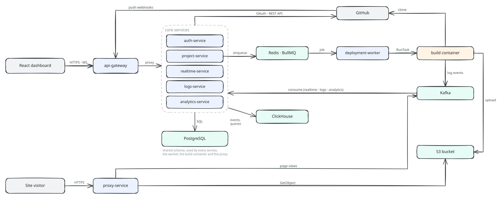

### Communication patterns

| Pattern                                             | Used for                                                                                                                              |
| --------------------------------------------------- | ------------------------------------------------------------------------------------------------------------------------------------- |
| **Synchronous HTTP (proxied)**                      | Browser → gateway → auth/project/analytics/logs services                                                                              |
| **Synchronous HTTP (internal, service-to-service)** | project-service and deployment-worker → auth-service `GET /internal/users/:id/github-token`, authenticated with `x-internal-api-key`  |
| **Job queue**                                       | project-service produces jobs, deployment-worker consumes them (BullMQ on Redis)                                                      |
| **Cloud control plane**                             | deployment-worker `RunTask`s, project-service `StopTask`s on ECS                                                                      |
| **Event streaming**                                 | deployment-service → Kafka `deployment-logs` → realtime-service + logs-service. proxy-service → Kafka `analytics` → analytics-service |
| **Pub/Sub**                                         | Socket.IO Redis adapter, so any realtime replica can emit to a room whose socket lives on another replica                             |
| **Shared database**                                 | All services that need project/deployment data read the same Postgres schema (`@repo/db`). project-service owns the migrations.       |

---

## 5. Services at a glance

| Service                | Port | Kind                          | Owns / writes                                                                                                  | Reads                                      | Talks to                          |
| ---------------------- | ---- | ----------------------------- | -------------------------------------------------------------------------------------------------------------- | ------------------------------------------ | --------------------------------- |
| **api-gateway**        | 3000 | HTTP + WS reverse proxy       | rate-limit counters (Redis)                                                                                    | sessions and blacklist (Redis)             | every upstream                    |
| **auth-service**       | 4000 | HTTP                          | `users` table, sessions, blacklist, OAuth state (Redis)                                                        | —                                          | GitHub OAuth/API                  |
| **project-service**    | 4001 | HTTP                          | `projects`, `deployments`, `project_environment_variables`, BullMQ jobs, webhook dedupe and Vite cache (Redis) | —                                          | GitHub API, auth-service, ECS, S3 |
| **queue-dashboard**    | 4002 | HTTP (Bull Board)             | —                                                                                                              | BullMQ (Redis)                             | —                                 |
| **realtime-service**   | 4003 | Socket.IO + Kafka consumer    | —                                                                                                              | `deployments`/`projects`, sessions (Redis) | Kafka, Redis adapter              |
| **analytics-service**  | 4004 | HTTP + Kafka consumer         | `page_views` (ClickHouse)                                                                                      | `projects`/`deployments`                   | Kafka, ClickHouse                 |
| **logs-service**       | 4005 | HTTP + Kafka consumer         | `log_events` (ClickHouse)                                                                                      | `projects`/`deployments`                   | Kafka, ClickHouse                 |
| **proxy-service**      | 8080 | HTTP (static hosting)         | —                                                                                                              | `projects`/`deployments`, S3               | Kafka producer                    |
| **deployment-worker**  | —    | BullMQ worker                 | deployment status on launch failure, user lock                                                                 | `deployments`/`projects`                   | auth-service, ECS                 |
| **deployment-service** | —    | One-shot container on Fargate | deployment status transitions, S3 objects                                                                      | `deployments`/`projects`/env vars          | GitHub (git), S3, Kafka, Redis    |

---

## 6. API gateway

The gateway is the **only** public entry point for the dashboard and for GitHub webhooks. It never parses request bodies. It streams them to upstreams with `http-proxy-middleware`.

### 6.1 Middleware pipeline

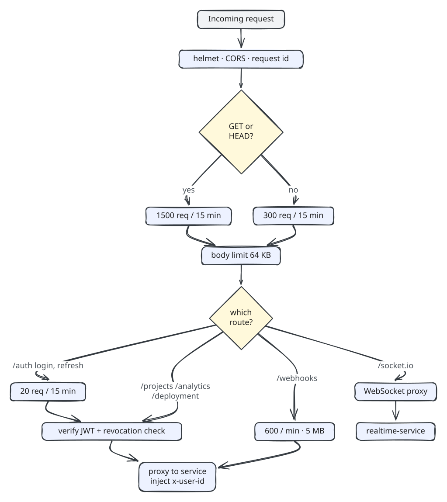

### 6.2 Authentication at the edge

`AuthenticateMiddleware` runs on `/auth`, `/projects`, `/analytics` and `/deployment`, except on the public routes `GET /auth/github`, `GET /auth/github/callback`, `POST /auth/refresh` and `POST /auth/logout`.

1. Extract the `Authorization: Bearer <jwt>` header.
2. Verify the token with `jose.jwtVerify`: HS256, issuer `auth-service`, audience `react-deployment-platform`. Require `typ === "access"` and the `sub`, `jti`, `sid` and `exp` claims.
3. **Revocation check** in Redis, in parallel: `EXISTS auth:blacklist:<jti>` and `EXISTS auth:refresh:<sid>`. The request is rejected if the token is blacklisted **or** its session no longer exists. Logging out therefore invalidates every outstanding access token of that session immediately, without waiting for the 15-minute expiry.
4. If Redis is unreachable, the gateway **fails closed** with `503 SERVICE_UNAVAILABLE`.

### 6.3 Identity propagation (trusted headers)

Downstream services do **not** verify JWTs themselves (except realtime-service, which terminates WebSockets directly). The proxy:

- **Always strips** any client-supplied `x-user-id` and `x-session-id` headers, so they cannot be spoofed.
- Injects `x-user-id: <sub>` and `x-session-id: <sid>` from the verified claims.
- Forwards `x-request-id` for end-to-end log correlation.

project-service, analytics-service and logs-service authenticate requests by validating that `x-user-id` is a UUID. This relies on the network rule that **only the gateway can reach them**.

### 6.4 Proxy robustness

| Concern                                     | Behaviour                                                                                                                                                                       |
| ------------------------------------------- | ------------------------------------------------------------------------------------------------------------------------------------------------------------------------------- |
| Upstream timeout                            | `PROXY_TIMEOUT_MS` (default 30 s) → `504 GATEWAY_TIMEOUT`                                                                                                                       |
| Upstream down (`ECONNREFUSED`, `ENOTFOUND`) | `503 SERVICE_UNAVAILABLE`                                                                                                                                                       |
| Other proxy errors                          | `502 BAD_GATEWAY`                                                                                                                                                               |
| Body size                                   | Declared `Content-Length` is checked up front. Chunked bodies are counted while streaming and the upstream request is destroyed past the limit, giving `413 PAYLOAD_TOO_LARGE`. |
| CORS                                        | Upstream `access-control-*` headers are removed so only the gateway's CORS policy applies                                                                                       |
| WebSockets                                  | `server.on("upgrade", realtimeProxy.upgrade)` forwards `/socket.io/` upgrades to realtime-service                                                                               |

### 6.5 Health

`GET /health` checks Redis, auth-service `/health` and project-service `/health` (each with a 3 s timeout) and returns `200` or `503` with a per-dependency `up`/`down` map.

---

## 7. Authentication and sessions

### 7.1 GitHub OAuth with PKCE

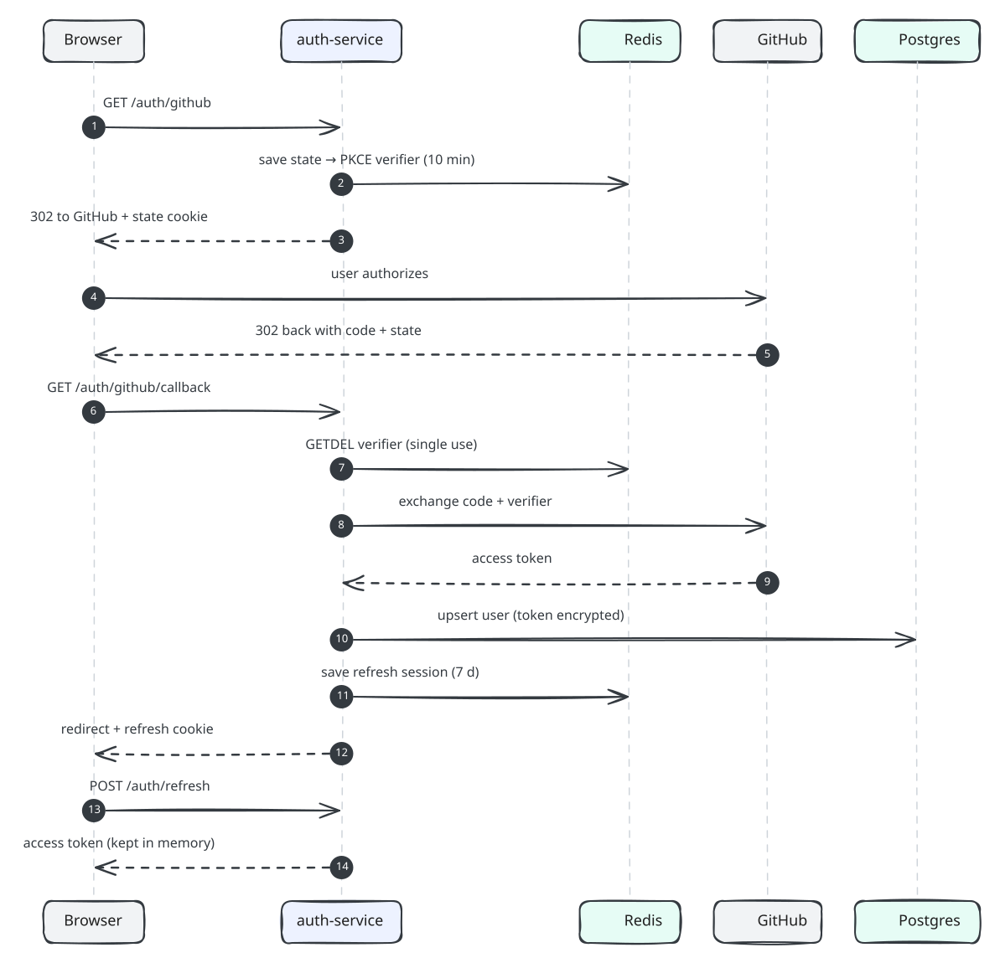

Key properties:

- **CSRF protection** comes from two checks: the `state` must match the `oauth_state` cookie in constant time, **and** it must exist in Redis. `GETDEL` makes it single-use, and it expires after 10 minutes.
- **PKCE (S256)** prevents authorization-code interception.
- The **GitHub token** is encrypted with AES-256-GCM (`v1.<iv>.<tag>.<ciphertext>`, base64url) using `GITHUB_TOKEN_ENCRYPTION_KEY`. Only auth-service can decrypt it.
- On any callback failure the browser is redirected to `/auth/callback?error=<ERROR_CODE>` rather than being shown a raw JSON error.

### 7.2 Token model

| Token   | Algorithm / secret                                                       | TTL    | Where it lives                                                                     | Claims                                                                              |
| ------- | ------------------------------------------------------------------------ | ------ | ---------------------------------------------------------------------------------- | ----------------------------------------------------------------------------------- |
| Access  | HS256 / `JWT_ACCESS_SECRET`                                              | 15 min | Browser memory only (never in storage)                                             | `sub` user id, `sid` session id, `jti`, `typ: "access"`, `iss`, `aud`, `iat`, `exp` |
| Refresh | HS256 / `JWT_REFRESH_SECRET` (must differ from access, enforced at boot) | 7 days | `refresh_token` httpOnly cookie, `SameSite=Strict`, `Path=/auth`, `Secure` in prod | same, `typ: "refresh"`                                                              |

The server-side session is **a single Redis key** `auth:refresh:<sessionId>` holding the SHA-256 hash of the _current_ refresh token. The raw token is never stored.

### 7.3 Refresh rotation with reuse detection

Every `POST /auth/refresh` issues a **new** refresh token and swaps the stored hash atomically with a Lua compare-and-set:

```lua
local current = redis.call("GET", KEYS[1])        -- auth:refresh:<sid>
if not current then return 0 end                   -- session gone
if current ~= ARGV[1] then return -1 end           -- presented hash ≠ stored hash
redis.call("SET", KEYS[1], ARGV[2], "EX", tonumber(ARGV[3]))
return 1
```

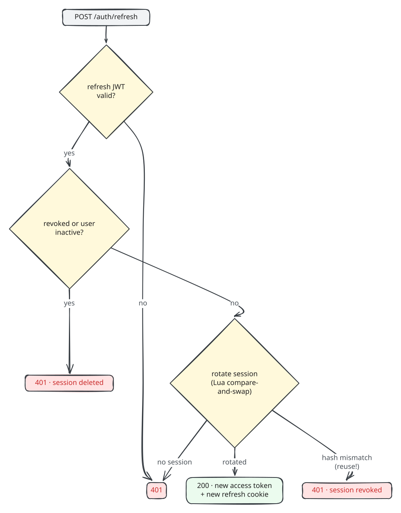

A hash mismatch means an **older** refresh token was presented after it had already been rotated. The token was most likely stolen, so the whole session is revoked. Because the gateway checks that the session key exists on every request, all access tokens of that session also stop working immediately.

### 7.4 Logout

`POST /auth/logout` (public route) verifies both tokens on a best-effort basis (`tryVerify`). It blacklists each valid `jti` with `SET auth:blacklist:<jti> 1 EX <remaining ttl>`, deletes every referenced session key and clears the cookie.

### 7.5 Internal token API

project-service and deployment-worker need the user's GitHub token to call the GitHub API and to clone repositories. They call:

```
GET /internal/users/:id/github-token
x-internal-api-key: <INTERNAL_API_KEY>
```

The key is compared as `timingSafeEqual(sha256(presented), sha256(expected))`. Hashing first makes the lengths equal, so the comparison does not leak length. `/internal/*` is **not** routed through the gateway and is exempt from auth-service's rate limiter. A missing or inactive user returns `404`, which callers translate to `GITHUB_AUTH_REQUIRED`.

---

## 8. Projects

### 8.1 Listing importable repositories

`GET /projects/repositories?page=N`

1. Fetch the GitHub token from auth-service.
2. `GET /user/repos?affiliation=owner,collaborator,organization_member&sort=pushed&per_page=30`. Keep only repositories the user can **push** to. Pagination comes from the `Link` header.
3. **Vite detection** runs for up to 6 repositories in parallel (`mapWithConcurrency`):
   - `GithubFilesystem` extends Vercel's `DetectorFilesystem`. It implements `hasPath`, `isFile`, `readFile` and `readdir` on top of the GitHub Contents API, memoises directory listings and caps file reads at 1 MB.
   - `detectFramework({ fs, frameworkList })` from `@vercel/fs-detectors` returns the framework slug, which must be `"vite"`.
   - The result is cached in Redis at `project:vite:<repoId>:<defaultBranch>:<pushedAt>` for 24 h. Because `pushedAt` is part of the key, a new push invalidates the cache automatically. Cache failures are logged and ignored.
4. Mark repositories that are already imported. A partial unique index enforces one active project per `(user, repo)`.

### 8.2 Creating a project

`POST /projects` with `{ repositoryId, packageManager, runtime?, installCommand?, buildCommand?, environmentVariables? }`

1. **Resolve defaults.** `runtime` defaults to `bun` when the package manager is bun, otherwise `node`. Install and build commands come from presets (`pnpm install` / `pnpm run build`, …).
2. **Command validation** (Zod `superRefine` plus a service-level check):
   - The first token of the install command must be a binary of the selected package manager (`npm|npx`, `pnpm|pnpx`, `yarn`, `bun|bunx`), otherwise `PACKAGE_MANAGER_COMMAND_MISMATCH`.
   - The first token of the build command must belong to the runtime (`node` runtime: node/npm/npx/pnpm/pnpx/yarn; `bun` runtime: bun/bunx), otherwise `RUNTIME_COMMAND_MISMATCH`.
3. Re-fetch the repository by id (it must still be pushable) and **assert that it is a Vite project** at the root of the default branch.
4. Encrypt each environment variable value with AES-256-GCM (`ENV_ENCRYPTION_KEY`).
5. **Generate a slug** of the form `adjective-noun` (cryptographic `randomInt`). Retry up to 10 times on a `projects_slug_unique_idx` violation (Postgres `23505`).
6. **One transaction** inserts the project, its first deployment (`trigger = "create"`, status `queued`) and its environment variables.
7. **Install the push webhook** on a best-effort basis (see §15). If the user lacks admin rights, the project is still created with `autoDeploy: false`.
8. **Enqueue** the deployment job.
9. Return `201` with the project, including `url = https://<slug>.<SITES_BASE_URL host>` and `latestDeployment`.

### 8.3 Updating a project

`PATCH /projects/:id` accepts any of `name`, `description`, `branch`, `rootDirectory`, `packageManager`, `runtime`, `installCommand`, `buildCommand` and `outputDirectory`.

- If `branch` or `rootDirectory` changes, the target location is re-verified as a Vite project on GitHub.
- If the package manager or runtime is switched without explicit commands, the install and build commands are **re-derived** from presets. If commands are supplied, they are validated against the effective package manager and runtime.
- Directories must be relative and must not contain `..`. The build container checks again at runtime (see §12).
- Existing deployments are unaffected because each deployment stores a **snapshot** of the settings.

### 8.4 Environment variables

| Rule            | Value                                                                             |
| --------------- | --------------------------------------------------------------------------------- |
| Key format      | `^[A-Za-z_][A-Za-z0-9_]*$`, ≤ 128 chars (also a DB `CHECK`)                       |
| Reserved keys   | `PATH`, `HOME`, `CI`, `COREPACK_ENABLE_DOWNLOAD_PROMPT`, `COREPACK_ENABLE_STRICT` |
| Value length    | ≤ 4096 chars                                                                      |
| Max per project | 64                                                                                |
| Storage         | AES-256-GCM ciphertext, unique `(project_id, key)`                                |
| API             | `GET` list (decrypted for the owner), `PUT /:key` upsert, `DELETE /:key`          |

---

## 9. Deployment lifecycle

### 9.1 State machine

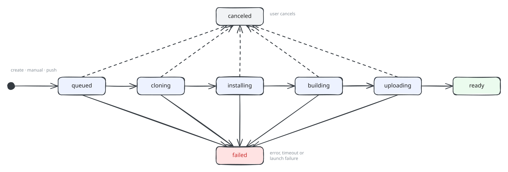

- **Active** statuses: `queued`, `cloning`, `installing`, `building`, `uploading`.
- **Terminal** statuses: `ready`, `failed`, `canceled`.
- Every transition is a **conditional `UPDATE ... WHERE status NOT IN (terminal)`**, which makes it a compare-and-set. If a user cancels mid-build, the container's next `transition()` updates zero rows. The pipeline then raises `"deployment was finalized by another process"` and stops, so a canceled deployment can never be flipped back to `building` or `ready`.
- `startedAt` is set once with `coalesce(started_at, now())`. `finishedAt` is set on every terminal transition. `errorMessage` is capped at 1000 characters and prefixed with the failed step, e.g. `[build] "npm run build" failed with exit code 1 ...`.

### 9.2 End-to-end flow

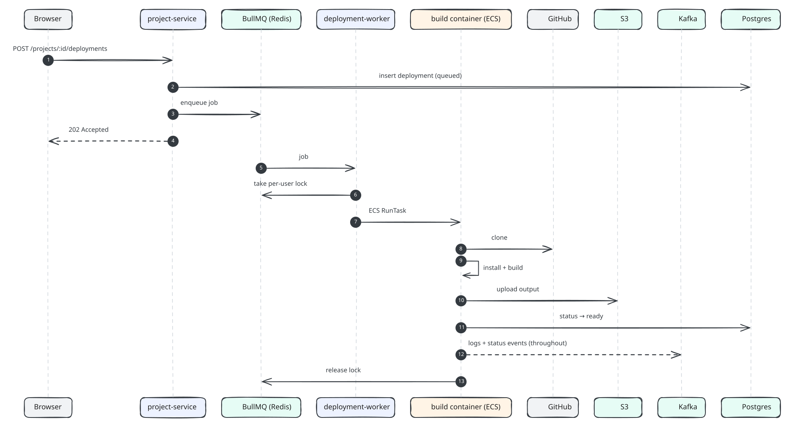

### 9.3 Triggers

| Trigger  | Source                           | What is built                                      |
| -------- | -------------------------------- | -------------------------------------------------- |
| `create` | `POST /projects`                 | Tip of the default branch                          |
| `manual` | `POST /projects/:id/deployments` | Tip of `project.branch`                            |
| `push`   | GitHub webhook                   | **Exact** `after` commit SHA from the push payload |

---

## 10. Deployment queue (BullMQ)

| Setting                             | Value                                               | Why                                                                                             |
| ----------------------------------- | --------------------------------------------------- | ----------------------------------------------------------------------------------------------- |
| Queue name                          | `deployments` (`@repo/contracts`)                   | Shared constant between producer, consumer and dashboard                                        |
| Payload                             | `{ deploymentId, userId }`                          | Minimal. Everything else is re-read from Postgres so stale data is never acted on               |
| `jobId`                             | `deploymentId`                                      | **Producer-side dedupe**: the same deployment cannot be enqueued twice                          |
| `attempts`                          | 3                                                   | Retries transient failures (auth-service down, ECS API errors)                                  |
| `backoff`                           | exponential, 5 s base                               | 5 s, 10 s, …                                                                                    |
| `removeOnComplete` / `removeOnFail` | keep last 1 000 / 5 000                             | Bounded Redis memory, keeps history for Bull Board                                              |
| Worker `concurrency`                | `DEPLOYMENT_WORKER_CONCURRENCY` (default 1)         | How many jobs one worker process handles at once. Builds themselves run in parallel on Fargate. |
| Redis connection                    | Dedicated ioredis with `maxRetriesPerRequest: null` | Required by BullMQ for blocking commands                                                        |

**Producer failure handling.** If `queue.add` throws (Redis down), project-service immediately runs `UPDATE ... SET status='failed', error_message='[initialize] the deployment could not be queued' WHERE status='queued'`, so a deployment never sits in `queued` with no job behind it.

**Consumer result values.** Each job resolves to `started`, `skipped` (no longer queued, or project deleted) or `failed` (permanent, e.g. GitHub authorization revoked).

**Worker `failed` handler.** Once `attemptsMade >= attempts`, the deployment is marked `failed` with `"[initialize] the deployment could not be started after several attempts"` and the user lock is released.

**Queue dashboard.** `queue-dashboard` mounts Bull Board at `/admin/queues` behind HTTP basic auth (`DASHBOARD_USERNAME`/`DASHBOARD_PASSWORD`). It lets you inspect waiting, delayed, active, completed and failed jobs and retry or clean them.

---

## 11. Concurrency control and the Redis lock

Builds are expensive. The platform therefore allows **at most one active deployment per user**. Other users' deployments still run in parallel, each on its own Fargate task. This is enforced by a Redis lock and backed by Postgres row locks and idempotency keys, which together cover the races described below.

### 11.1 The lock

| Property | Value                                                                                                |
| -------- | ---------------------------------------------------------------------------------------------------- |
| Key      | `deployments:user:<userId>:active`                                                                   |
| Value    | The `deploymentId` that owns the lock (the **fencing identity**)                                     |
| Acquire  | `SET key <deploymentId> EX <DEPLOYMENT_LOCK_TTL_SECONDS=3600> NX`                                    |
| Release  | Lua _compare-and-delete_. The key is deleted only if it still holds this deployment id.              |
| TTL      | 1 hour, a safety net if every release path fails (for example, a container is killed with `SIGKILL`) |

```lua
-- RELEASE_IF_OWNER_SCRIPT (identical in worker, container and project-service)
if redis.call("get", KEYS[1]) == ARGV[1] then
  return redis.call("del", KEYS[1])
end
return 0
```

Storing the owner's id and releasing only if it matches means that a **late or duplicate release can never delete a lock now held by a different deployment**. For example, a cancel request for deployment A might arrive after A already finished and deployment B took the lock. That release does nothing.

### 11.2 Acquisition algorithm (deployment-worker)

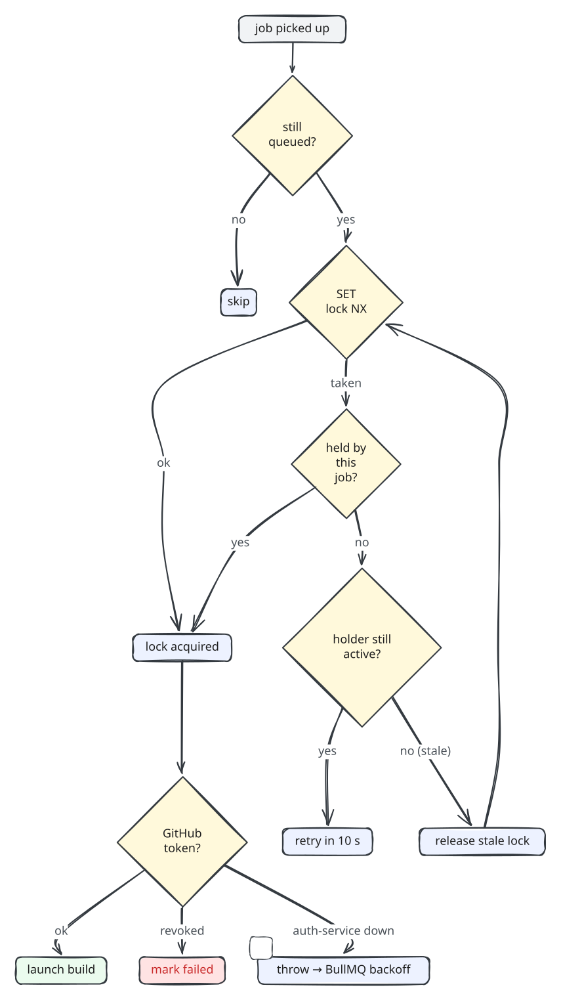

Design points:

- **Delaying without burning retries.** When the user already has an active deployment, the job is moved to BullMQ's _delayed_ set with `job.moveToDelayed(Date.now() + DEPLOYMENT_LOCK_RETRY_DELAY_MS, token)` and `DelayedError` is thrown. BullMQ treats this as a reschedule, **not a failure**, so a user can queue several deployments and they run one after another without using up the three retry attempts.
- **Re-entrancy.** If the worker crashes after acquiring the lock and BullMQ redelivers the job, `holder == deploymentId` lets the retry continue.
- **Stale-lock recovery.** If the lock points at a deployment that is terminal or deleted (for example, a container that died before releasing), the worker releases it with the owner-checked Lua script and tries again. A competing worker that wins the `SET NX` race simply causes this job to be delayed.
- **Ownership handoff.** After a successful `RunTask`, the worker keeps the lock. The **container** releases it when it exits.

### 11.3 Who releases the lock

| Releaser                     | When                                                                                                                                                                                          |
| ---------------------------- | --------------------------------------------------------------------------------------------------------------------------------------------------------------------------------------------- |
| deployment-worker            | GitHub token missing, launch `skipped` or `failed`, final job failure after all attempts, stale-holder cleanup                                                                                |
| deployment-service container | In its `exit()` path, on success, failure, `SIGTERM`/`SIGINT` (ECS `StopTask`), unhandled rejection or uncaught exception. It opens a fresh Redis connection just for this, then disconnects. |
| project-service              | On **cancel** (after stopping the task) and on **project delete**, for every deployment that was active                                                                                       |
| Redis TTL                    | After 1 h, if nothing else released it                                                                                                                                                        |

### 11.4 Additional guards against races

The Redis lock serialises builds per user. The guards below cover the remaining races between deployments and other operations.

| Race                                                                       | Guard                                                                                                                                                                                                                                                                                                                                                                                  |
| -------------------------------------------------------------------------- | -------------------------------------------------------------------------------------------------------------------------------------------------------------------------------------------------------------------------------------------------------------------------------------------------------------------------------------------------------------------------------------- |
| Same deployment enqueued twice                                             | BullMQ `jobId = deploymentId`                                                                                                                                                                                                                                                                                                                                                          |
| Same deployment launched twice (worker retry after a timeout on `RunTask`) | ECS `RunTask` with `clientToken = deploymentId`, which is idempotent on AWS's side                                                                                                                                                                                                                                                                                                     |
| Launch races with project deletion                                         | The worker runs `RunTask` **inside** a transaction holding `SELECT ... FOR KEY SHARE OF projects` on a row that must still be `queued` and not deleted. Deletion takes `SELECT ... FOR UPDATE` on the same project row, which conflicts with `KEY SHARE`. Either the delete waits until the task is launched (and then stops it), or the launch sees the project deleted and skips it. |
| New deployment created while the project is being deleted                  | `DeploymentRepository.createForProject` inserts inside a transaction holding `FOR KEY SHARE` on the project, and returns `undefined` if it is already soft-deleted                                                                                                                                                                                                                     |
| Cancel races with the container's progress                                 | Status transitions are conditional on a non-terminal status (CAS). The canceled state always wins.                                                                                                                                                                                                                                                                                     |
| Container started for a deployment that was canceled before boot           | The container's initialize step re-checks `status === "queued"` and exits as `skipped`                                                                                                                                                                                                                                                                                                 |
| Duplicate webhook deliveries                                               | `SET webhooks:delivery:<id> 1 EX 86400 NX` (see §15)                                                                                                                                                                                                                                                                                                                                   |

---

## 12. The build container (deployment-service)

`deployment-service` is **not** a long-running server. It is a one-shot program packaged as a Docker image and launched as an ECS Fargate task, once per deployment. The image is based on Ubuntu 24.04 with Node 22, corepack (pnpm/yarn), Bun 1.4, git and `tini` as PID 1, so that signals are forwarded and zombie processes are reaped. It runs as the non-root `ubuntu` user.

### 12.1 Inputs

Passed as ECS container overrides:

| Variable                 | Meaning                                                                                                                                            |
| ------------------------ | -------------------------------------------------------------------------------------------------------------------------------------------------- |
| `DEPLOYMENT_ID`          | Deployment to build                                                                                                                                |
| `USER_ID`                | Expected owner. The container verifies `project.userId === USER_ID`.                                                                               |
| `GITHUB_TOKEN_ENCRYPTED` | User's GitHub token encrypted by the worker with `ENV_ENCRYPTION_KEY`. It is never visible in plaintext in the ECS task definition or the console. |

### 12.2 Pipeline

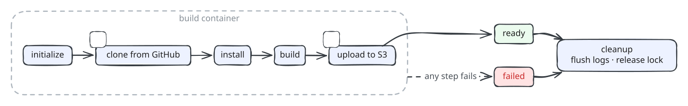

Each step emits `step started`, `step completed` or `step failed` events with durations. Each status transition emits a `status` event.

**Initialize**

- Loads the deployment and project. Skips if the deployment is no longer `queued`. Fails if the owner does not match or the project is deleted.
- **Path traversal guard:** `resolveInside(workspace, rootDirectory)` and `resolveInside(projectDir, outputDirectory)` must not escape the workspace (checked with `path.relative`).
- Decrypts the GitHub token and every environment variable, then registers them all with the **log redactor** (see §13.3).

**Clone** (`simple-git`, 5 min block timeout, `GIT_TERMINAL_PROMPT=0`, ambient `GIT_*` variables stripped)

- With a commit SHA (push deployments): `git init`, then `git fetch --depth 1 --no-tags <url> <sha>`, then `git checkout --detach FETCH_HEAD`.
- Without one: `git clone --depth 1 --single-branch --branch <branch>`.
- The authenticated URL is `https://x-access-token:<token>@github.com/<owner>/<repo>.git`. The repository URL must match a strict GitHub regex first. Error messages are scrubbed of the raw and URL-encoded token.
- Verifies `git rev-parse HEAD` is a 40-character SHA and, for pinned builds, equals the requested SHA. The resolved SHA is stored on the deployment.

**Install / Build** (`child_process.spawn(command, { shell: true })`)

- **Sandboxed environment.** The child sees _only_ the project's environment variables plus `PATH`, `HOME`, `CI=true`, `COREPACK_ENABLE_DOWNLOAD_PROMPT=0` and `COREPACK_ENABLE_STRICT=0`. Platform secrets (database URL, AWS keys, Kafka credentials, encryption key) are **not** inherited. The sandbox values are spread last, so a user variable cannot override them, and those keys are also rejected by validation.
- Timeout `BUILD_TIMEOUT_MS` (default 15 min) through `AbortSignal.timeout`, then `SIGKILL`.
- stdout and stderr are read line by line (`readline`) and streamed as `stdout`/`stderr` log events. A 30 s heartbeat logs `still running after …`.
- On a non-zero exit, the error message includes the exit code or signal plus the **last 20 output lines**.

**Upload**

- `globby("**/*", { dot: true, onlyFiles: true, followSymbolicLinks: false })`. Not following symlinks prevents a malicious build from exfiltrating files outside the output directory through a link. An empty output directory fails the deployment.
- Files go to `s3://<bucket>/__outputs/<deploymentId>/<path>` with `@aws-sdk/lib-storage` `Upload` (automatic multipart). Up to `UPLOAD_CONCURRENCY` (8) run in parallel, and `Content-Type` comes from `mime-types`.
- Progress is logged every 10 %, plus per-file logs when there are 25 files or fewer.

**Finalize**

- `markReady` (CAS). From this moment the proxy serves the new deployment, because it resolves the **latest `ready`** deployment by `finished_at`.

### 12.3 Shutdown semantics

| Event                                                   | Behaviour                                                                                                                                        |
| ------------------------------------------------------- | ------------------------------------------------------------------------------------------------------------------------------------------------ |
| Normal finish                                           | `exit(0)`: release lock, close collector (emit `end`, drain buffer up to 10 s), flush and disconnect the producer, close the PG pool, flush pino |
| Pipeline error                                          | Mark `failed` with `[step] message`, emit `status failed`, `exit(1)`                                                                             |
| `SIGTERM`/`SIGINT` (ECS `StopTask` on cancel or delete) | `abort()`: emit `status failed`, `markFailed` (a no-op if already `canceled`, thanks to CAS), then the same `exit()` path                        |
| Kafka unavailable at boot                               | The deployment still runs. Logs are written only to the container's stdout (CloudWatch), and the collector runs in mirror-only mode.             |
| `finally`                                               | `rm -rf` the workspace, always                                                                                                                   |

---

## 13. Realtime log pipeline

This is the most involved part of the system: build output has to reach the browser **live**, **in order**, **without duplicates or gaps**, and remain **replayable** after the fact, with secrets masked along the way.

### 13.1 Overview

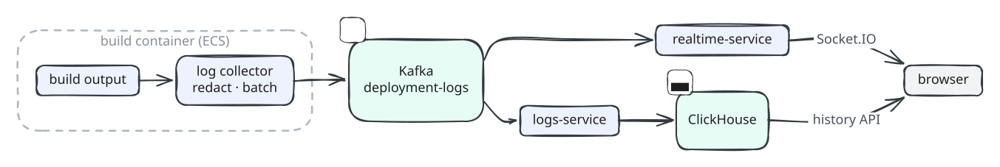

The topic is consumed by **two independent consumer groups**. Each group gets every message: one group streams to browsers and the other stores the history.

### 13.2 Event schema (v1)

Every event shares this envelope:

```jsonc
{
  "schemaVersion": 1,
  "deploymentId": "0193…",
  "projectId": "0193…",          // null until the project is loaded
  "sequence": 42,                 // strictly increasing per deployment, starts at 1
  "timestamp": "2026-11-07T10:00:00.000Z",
  "message": "human readable line",
  "type": "log" | "step" | "status" | "end",
  ...
}
```

| `type`   | Extra fields                                                                                        | Example `message`                                              |
| -------- | --------------------------------------------------------------------------------------------------- | -------------------------------------------------------------- |
| `log`    | `level` (`debug`/`info`/`warn`/`error`), `step`, `source` (`system`/`stdout`/`stderr`), `truncated` | `vite v6.0.0 building for production...`                       |
| `step`   | `step`, `phase` (`started`/`completed`/`failed`), `durationMs`, `error`                             | `Build step completed in 12.4s`                                |
| `status` | `status` (deployment status), `error`                                                               | `Deployment status changed to building: building your project` |
| `end`    | `status` (final), `droppedCount`                                                                    | `Deployment log stream ended with status ready`                |

Kafka message metadata: `key = deploymentId`, `timestamp = event time`, and headers `schema-version`, `event-type` and `content-type: application/json`.

**Ordering guarantee.** Because the key is `deploymentId`, all events of a deployment go to the **same partition**, and Kafka preserves order within a partition. The producer is **idempotent** with `acks=-1` and `maxInFlightRequests=5`, so retries cannot reorder or duplicate messages within a producer session. The `sequence` number lets every consumer and the browser order and deduplicate independently of Kafka.

### 13.3 The producer side: `DeploymentLogCollector`

**Sanitisation**, applied to every line before anything else:

1. `stripTerminalFormatting`: removes ANSI/CSI escape sequences, keeps only the text after the last `\r` (so progress bars that redraw a line collapse to their final state), strips other control characters and trims trailing whitespace.
2. **Secret redaction**: `createRedactor(secrets)` compiles a single regex from every secret of 8 characters or more (the GitHub token and all environment variable values), **plus their URL-encoded and base64 forms**. Patterns are sorted longest-first and each match becomes `***`. The same redactor is applied to step errors and status errors.
3. `truncateUtf8`: caps a line at `DEPLOYMENT_LOG_MAX_LINE_BYTES` (8 KB) **without splitting a multi-byte UTF-8 character**, by walking back over `10xxxxxx` continuation bytes. Sets `truncated: true`.

**Batching and backpressure**

| Knob                               | Default | Meaning                                                                          |
| ---------------------------------- | ------- | -------------------------------------------------------------------------------- |
| `DEPLOYMENT_LOG_FLUSH_INTERVAL_MS` | 250 ms  | Periodic flush (`setInterval`, `unref`'d)                                        |
| `DEPLOYMENT_LOG_BATCH_SIZE`        | 500     | Flush immediately when the buffer reaches this size, and max messages per `send` |
| `DEPLOYMENT_LOG_BUFFER_LIMIT`      | 20 000  | Maximum buffered events before load-shedding                                     |

- **Single-flight flush.** `flush()` reuses an in-progress promise (`this.flushing ??= ...`), so there is never more than one `send` in flight from the collector, which preserves order.
- **Retry with exponential backoff.** On a failed `send`, the in-flight batch is **put back at the front** of the buffer (`[...inFlight, ...buffer]`) and the next attempt waits `min(200ms · 2^(n-1), 5s)`.
- **Load-shedding policy.** When the buffer is full, the **oldest droppable event** is evicted. Only `log` events from `stdout`/`stderr` can be dropped. `system` logs, `step`, `status` and `end` events are **never dropped**, so the browser always learns the outcome. Dropped lines are counted and reported as a `warn` line (`N log lines were dropped because the log pipeline fell behind`) and in the final `end` event's `droppedCount`.
- **Mirroring.** Every event is also written to the container's own pino logger (and so to CloudWatch), even if Kafka is down.
- **Drain on close.** `close()` emits the `end` event (no further events are accepted after this), then flushes repeatedly until the buffer and in-flight batch are both empty or the 10 s deadline passes. The producer is then `flush()`ed and disconnected.

**Producer configuration** (librdkafka through `@confluentinc/kafka-javascript`):

```
idempotent: true, acks: -1 (all ISR), maxInFlightRequests: 5
compression: zstd, linger.ms: 20, batch.num.messages: 10000, batch.size: 1 MB
message.timeout.ms: 30000, retry.backoff.ms: 200 → 2000
queue.buffering.max.messages: 100000, allowAutoTopicCreation: false
TLS (CA pinned via ssl.ca.location, hostname verification) + SASL SCRAM-SHA-256/512 or PLAIN
```

### 13.4 Live fan-out: realtime-service

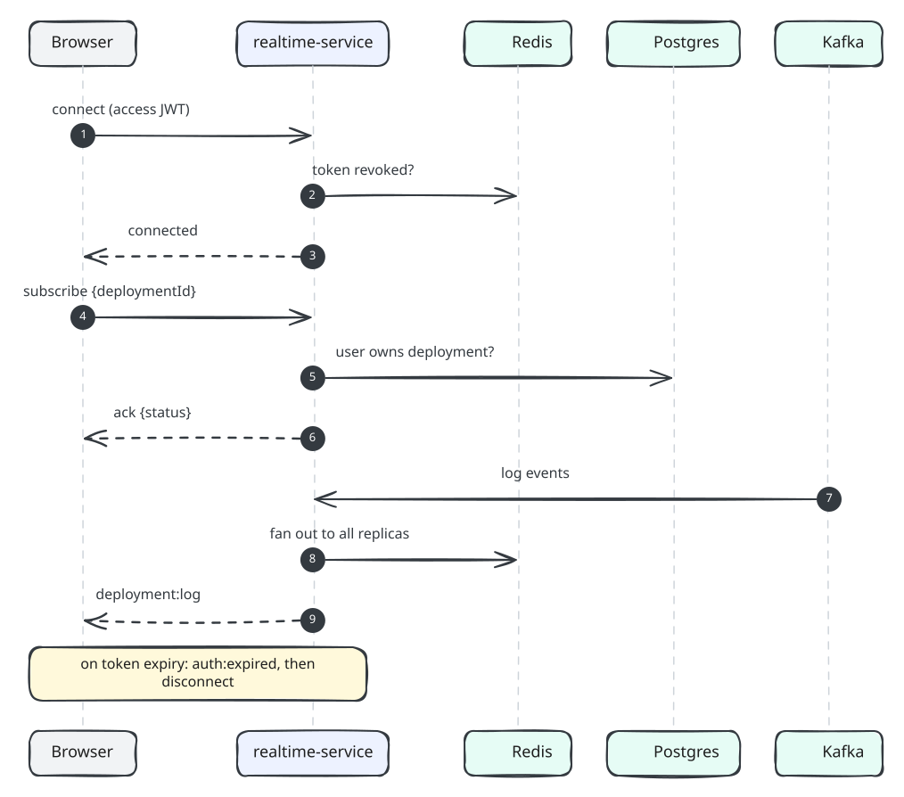

- **Authentication in the handshake.** The token comes from `socket.handshake.auth.token`. Failures are rejected with structured `data.code` values (`UNAUTHORIZED`, `INVALID_TOKEN`, `SERVICE_UNAVAILABLE`) so the client can tell auth errors apart from outages.
- **Token expiry.** A per-socket timer fires at the JWT's `exp`, emits `auth:expired` and disconnects. The client fetches a fresh access token through `/auth/refresh` and reconnects, rate-limited to one re-auth every 10 s.
- **Authorization.** A socket can only join `deployment:<id>` rooms for deployments of projects it owns. There is a hard cap of `SOCKET_MAX_SUBSCRIPTIONS_PER_CLIENT` (10) rooms per connection, and `maxHttpBufferSize` is limited to 10 KB.
- **Horizontal scaling.** All realtime replicas share the consumer group `realtime-service`, so Kafka splits the partitions between them. A replica that receives an event calls `io.to(room).emit(...)`, and the **Redis adapter** (`@socket.io/redis-adapter` on dedicated publisher and subscriber connections) delivers it to sockets connected to _any_ replica. Every message is therefore consumed once per cluster and delivered to every subscriber.
- **Offsets.** `fromBeginning=false`: realtime only cares about new events. History comes from logs-service.

**Socket.IO contract**

| Direction       | Event                    | Payload                  | Ack                                                                                                                                                            |
| --------------- | ------------------------ | ------------------------ | -------------------------------------------------------------------------------------------------------------------------------------------------------------- |
| client → server | `deployment:subscribe`   | `{ deploymentId: uuid }` | `{ ok: true, data: { deploymentId, status } }` or `{ ok: false, code: VALIDATION_ERROR \| SUBSCRIPTION_LIMIT \| NOT_FOUND \| INTERNAL_SERVER_ERROR, message }` |
| client → server | `deployment:unsubscribe` | `{ deploymentId: uuid }` | `{ ok: true, data: { deploymentId } }`                                                                                                                         |
| server → client | `deployment:log`         | `DeploymentLogMessage`   | —                                                                                                                                                              |
| server → client | `auth:expired`           | —                        | —                                                                                                                                                              |

### 13.5 Persistence: logs-service

- Consumer group **`log-worker`** (named for compatibility with the service's previous name; keep it so offsets are preserved), `eachBatch`.
- Each message is parsed as JSON and validated with a loose Zod schema (`deploymentId`, `projectId`, `message`, other fields passed through). Malformed or non-JSON messages are **logged and skipped** rather than blocking the partition.
- The batch is inserted into ClickHouse in **one** `INSERT ... FORMAT JSONEachRow`. Each row gets a fresh `event_id`, and every field except `deploymentId`, `projectId` and `message` is stored as a JSON string in `metadata`.
- **At-least-once delivery.** If the insert fails, the handler waits 1 s, sends a heartbeat (to keep its group membership) and **rethrows**, so the batch is redelivered from the uncommitted offset. Redelivery can create duplicates, which are removed at read time.

```sql
CREATE TABLE log_events (
  event_id      UUID,
  timestamp     DateTime MATERIALIZED now(),
  deployment_id String,
  project_id    String,
  log           String,
  metadata      Nullable(String)
) ENGINE = MergeTree
PARTITION BY toYYYYMM(timestamp)
ORDER BY (timestamp);
```

**Read path:** `GET /deployment/:id/logs?after=<seq>&limit=<n>` (default 500, max 1000)

```sql
SELECT toString(event_id) AS id,
       JSONExtractUInt(metadata, 'sequence') AS sequence,
       toString(timestamp) AS loggedAt, metadata, log AS message
FROM log_events
WHERE deployment_id = {deploymentId:String}
  AND sequence > {after:UInt64}
ORDER BY sequence ASC, timestamp ASC
LIMIT 1 BY sequence          -- read-time dedupe of at-least-once duplicates
LIMIT {limit:UInt32}
```

The service fetches `limit + 1` rows to compute `hasMore` and returns `{ items, nextAfter, hasMore }`. Ownership is checked against Postgres first, so a deployment you do not own returns `404`.

### 13.6 Gap-free merge in the browser

The frontend's `DeploymentLogStore` combines the two sources so that none of the race conditions between "history" and "live" lose or duplicate a line:

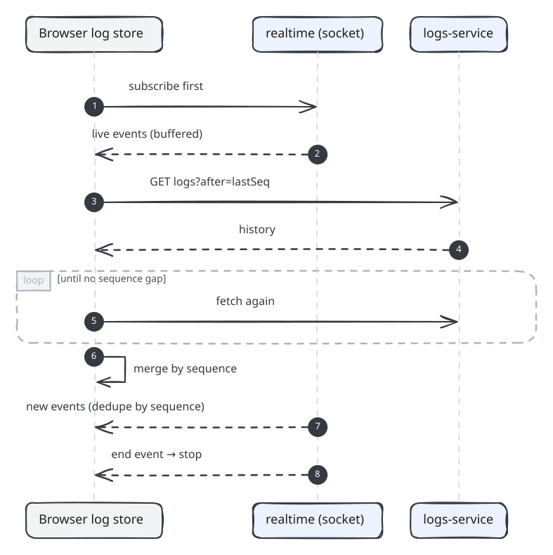

- **Subscribe before fetching.** Subscribing first guarantees that any event emitted while history is loading is caught in the buffer.
- **Dedupe by `sequence`** with a `Set<number>` of known sequences. Out-of-order arrivals trigger a sorted merge, and in-order arrivals are a cheap `concat`.
- **Gap detection.** logs-service persists asynchronously and can be behind realtime. If the lowest buffered sequence is more than one ahead of the last historical sequence, the store waits and re-fetches.
- **Reconnects.** On socket reconnect the store re-subscribes and re-fetches with `after = lastSequence`. If live updates are unavailable it shows an `offline` phase and periodically resyncs from history.
- **Terminal handling.** For deployments that are already finished, the store skips the socket and loads history only. A `status` event invalidates the deployment detail query, and the `end` event invalidates the project and deployment lists.

---

## 14. Cancellation and project deletion

### 14.1 Cancel a deployment

`POST /projects/:id/deployments/:deploymentId/cancel`

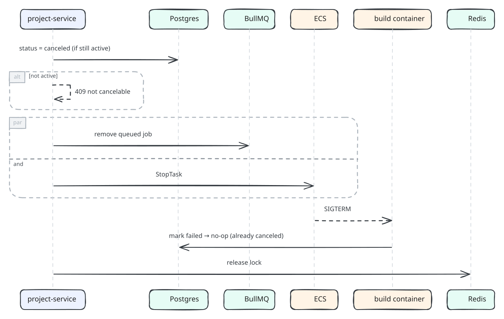

- The `canceled` status is written **first**, so whatever the worker or container does next sees a terminal state and backs off.
- `startedBy = deploymentId` on `RunTask` is what allows the task to be found later without storing task ARNs.

### 14.2 Delete a project

`DELETE /projects/:id` runs in **one Postgres transaction**:

1. `SELECT project ... FOR UPDATE`. This blocks concurrent launches and new deployments, which hold `FOR KEY SHARE` on the same row.
2. Load all of the project's deployments and set `deleted_at = now()` (soft delete).
3. **Cleanup callback, still inside the transaction:**
   - Remove queued jobs for active deployments.
   - `StopTask` and **wait until the tasks are stopped** (`waitUntilTasksStopped`, max 120 s, 8 in parallel). This guarantees that no container is still uploading to S3.
   - Delete every S3 object under `__outputs/<deploymentId>/` for every deployment (paginated `ListObjectsV2` and `DeleteObjects` in batches, 8 deployments in parallel). Any per-object error aborts the transaction.
4. `DELETE FROM deployments WHERE project_id = ...`
5. Commit, then release the user locks held by previously active deployments, and remove the GitHub webhook on a best-effort basis.

The soft-deleted project row is kept. Its slug stays reserved by the unique index, and the partial unique index on `(user_id, github_repository_id) WHERE deleted_at IS NULL` lets the same repository be imported again.

---

## 15. GitHub webhooks and auto-deploy

### 15.1 Installation

On project creation, or explicitly with `POST /projects/:id/webhook`:

- Generate a 32-byte random hex secret.
- `POST /repos/{owner}/{repo}/hooks` with `events: ["push"]`, `content_type: json`, `insecure_ssl: "0"` and `url = PUBLIC_API_URL/webhooks/github/projects/<projectId>`.
- If GitHub returns `422` (a hook with that URL already exists), find it with `GET /hooks` and `PATCH` it with the new secret, which makes installation idempotent.
- `403`/`404` means the user is not a repository admin. The project is stored without a webhook (`autoDeploy: false`), and the explicit endpoint returns `422 WEBHOOK_PERMISSION_DENIED`.
- `github_webhook_id` and the **encrypted** `github_webhook_secret` are stored together. A `CHECK` constraint enforces that both are null or both are set.

### 15.2 Delivery handling

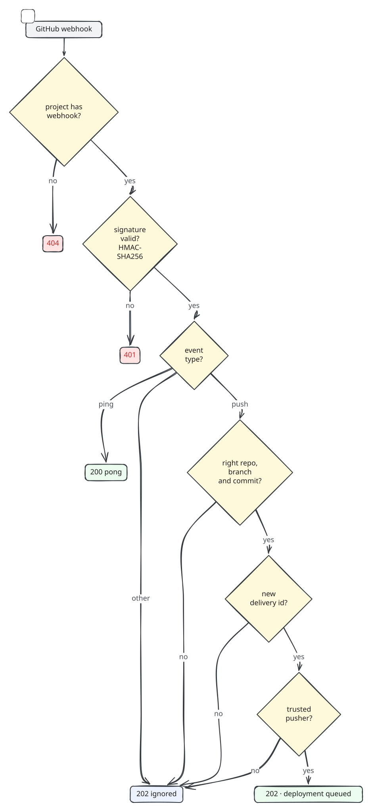

Notable details:

- **Signature verification uses the raw bytes.** The `/webhooks` route is mounted with `express.raw({ type: "application/json" })` _before_ `express.json()`, and the gateway never parses bodies. The HMAC is therefore computed over exactly what GitHub signed.
- **Idempotency** comes from GitHub's `x-github-delivery` id and Redis `SET NX` with a 24 h TTL. If processing fails after the key is set, the key is **deleted**, so a manual redelivery from GitHub can succeed.
- **Trusted pusher.** Pushes from non-collaborators (for example, via a fork workflow) are ignored. This prevents someone else from triggering builds that run with the project owner's token and secrets.
- Push deployments build the **exact commit** in the payload, not "whatever is on the branch now".

---

## 16. Serving deployed sites (proxy-service)

proxy-service serves user sites on wildcard subdomains of `ROOT_DOMAIN`.

### 16.1 Request flow

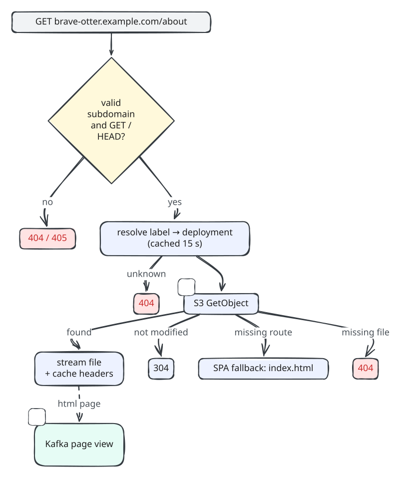

### 16.2 Caching strategy

| Path            | `Cache-Control`                       | Rationale                                                                               |
| --------------- | ------------------------------------- | --------------------------------------------------------------------------------------- |
| `*.html`        | `no-cache`                            | Always revalidate (cheap 304 through the ETag) so a new deployment shows up immediately |
| `assets/*`      | `public, max-age=31536000, immutable` | Vite emits content-hashed file names                                                    |
| everything else | `public, max-age=0, must-revalidate`  |                                                                                         |

Express's own ETag generation is disabled. The **S3 object ETag** is passed through and `If-None-Match` is forwarded to S3, so 304s are produced by S3 without streaming the body.

### 16.3 Atomic releases and rollbacks

A deployment's files are written under a unique prefix (`__outputs/<deploymentId>/`) and become visible only when the status flips to `ready`. Switching versions is therefore just a database state change, propagated within the 15 s resolver cache TTL. Older deployments stay addressable at `https://<deploymentId>.<root-domain>` for previews and pinned links.

---

## 17. Analytics pipeline

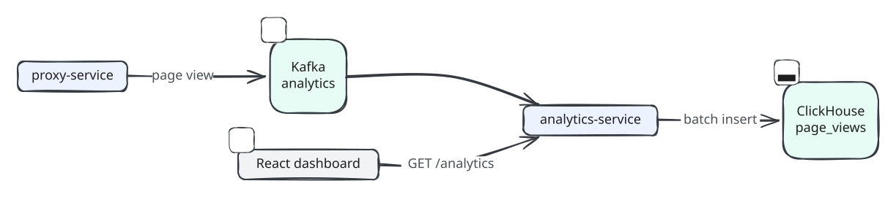

- **Producer** (proxy-service): one lazily created shared producer, `acks: 1`, fire-and-forget. A failed publish is logged and never affects the visitor's response. The route is normalised (trailing slash removed) and capped at 2048 characters. Only successfully streamed **HTML** responses count as page views.
- **Consumer**: the same batch, validate (`pageViewEventSchema` from `@repo/contracts`), insert, and on error wait 1 s, heartbeat and rethrow, giving at-least-once delivery.

```sql
CREATE TABLE page_views (
  event_id      UUID,
  timestamp     DateTime MATERIALIZED now(),
  site          String,
  deployment_id String,
  route         String
) ENGINE = MergeTree
PARTITION BY toYYYYMM(timestamp)
ORDER BY (deployment_id, route, timestamp);
```

### 17.1 Analytics API computation

For `range ∈ {24h, 7d, 30d}` (H = 24, 168 or 720 hours):

1. Check ownership, then list **all deployment ids of the project**. Analytics span every deployment of the project.
2. `from = floor(now / 3600) · 3600 − (H − 1) · 3600`, i.e. H hourly buckets that **include the current hour**. `previousFrom = from − H · 3600`.
3. Run three ClickHouse queries in parallel:
   - **hourly**: `intDiv(toUnixTimestamp(timestamp), 3600) * 3600 AS bucket, count() GROUP BY bucket`
   - **top routes**: `GROUP BY route ORDER BY views DESC, route ASC LIMIT 5`
   - **period totals**: `countIf(timestamp < from)` for the previous period and `uniqExactIf(route, timestamp >= from)` for unique routes
4. Post-process in TypeScript: zero-fill missing hours, total views, peak hour, average per hour, the share of each top route plus an `"Other"` slice, and `changePercent` compared with the previous period (`null` when the previous period had no views).

---

## 18. Data model

### 18.1 PostgreSQL

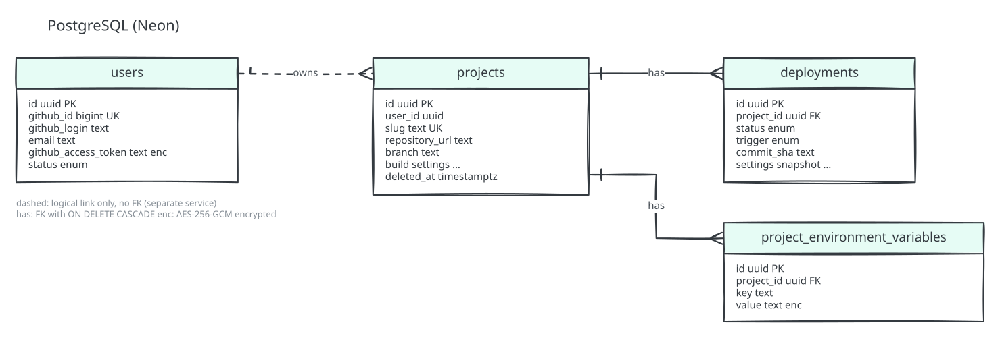

**Indexes**

| Table       | Index                                                                        | Purpose                                                      |
| ----------- | ---------------------------------------------------------------------------- | ------------------------------------------------------------ |
| projects    | `projects_slug_unique_idx` (unique)                                          | Subdomain routing, slug collision retry                      |
| projects    | `(user_id, github_repository_id) WHERE deleted_at IS NULL` (unique, partial) | One active project per repo per user, re-import after delete |
| projects    | `(user_id, created_at)`                                                      | Project list ordering                                        |
| projects    | `deleted_at WHERE deleted_at IS NOT NULL` (partial)                          | Soft-delete housekeeping                                     |
| deployments | `(project_id, created_at)`                                                   | Deployment list, latest deployment (`DISTINCT ON`)           |
| deployments | `status`                                                                     | Status-filtered lookups                                      |
| env vars    | `(project_id, key)` (unique)                                                 | Upsert target                                                |
| users       | `github_id` (unique)                                                         | OAuth upsert target                                          |

**Other notes**

- Primary keys are **UUIDv7**: time-ordered, so B-tree inserts stay local and `ORDER BY created_at, id` is stable.
- `updated_at` is maintained by a `BEFORE UPDATE` trigger (`set_updated_at()`).
- **Migrations:** auth-service owns `users` (`apps/auth-service/drizzle`). project-service owns the shared schema in `packages/db` (`apps/project-service/drizzle`, migrations table `__drizzle_migrations_project_service`). drizzle-kit uses the **direct** (non-pooler) Neon URL, derived by stripping `-pooler.`.
- **Connection pool:** `@neondatabase/serverless` `Pool` over WebSockets, `max 10`, idle 30 s, connect timeout 5 s, Drizzle with `casing: "snake_case"`.

### 18.2 Redis keyspace

| Key                                                                                                                    | Type / value                         | TTL                 | Owner                                | Purpose                                   |
| ---------------------------------------------------------------------------------------------------------------------- | ------------------------------------ | ------------------- | ------------------------------------ | ----------------------------------------- |
| `auth:oauth-state:<state>`                                                                                             | PKCE verifier                        | 600 s               | auth-service                         | OAuth CSRF + PKCE, consumed with `GETDEL` |
| `auth:refresh:<sessionId>`                                                                                             | SHA-256 of the current refresh token | 7 d                 | auth-service                         | Session existence + rotation CAS          |
| `auth:blacklist:<jti>`                                                                                                 | `"1"`                                | remaining token TTL | auth-service                         | Access/refresh token revocation           |
| `deployments:user:<userId>:active`                                                                                     | owning `deploymentId`                | 3600 s              | worker / container / project-service | Per-user deployment lock                  |
| `webhooks:delivery:<deliveryId>`                                                                                       | `"1"`                                | 24 h                | project-service                      | Webhook idempotency                       |
| `project:vite:<repoId>:<branch>:<pushedAt>`                                                                            | `"1"` / `"0"`                        | 24 h                | project-service                      | Framework detection cache                 |
| `bull:deployments:*`                                                                                                   | BullMQ structures                    | managed             | BullMQ                               | Deployment queue                          |
| `gateway-rate-limit:*`, `gateway-read-rate-limit:*`, `gateway-credential-rate-limit:*`, `gateway-webhook-rate-limit:*` | counters                             | window              | api-gateway                          | Distributed rate limiting                 |
| `rate-limit:*`                                                                                                         | counters                             | window              | auth-service                         | Rate limiting                             |
| `project-rate-limit:*`, `project-read-rate-limit:*`                                                                    | counters                             | window              | project-service                      | Rate limiting                             |
| `socket.io#*` channels                                                                                                 | pub/sub                              | —                   | realtime-service                     | Cross-replica room broadcast              |

Logically there are **two Redis roles**, which may be one instance or two:

- **Auth Redis**: sessions and blacklist, read by auth-service, api-gateway and realtime-service. All three must point at the same instance.
- **Queue Redis**: BullMQ, the deployment lock, webhook dedupe and the Vite cache, used by project-service, deployment-worker, deployment-service and queue-dashboard. All four must point at the same instance, because the lock is acquired and released from all of them.

### 18.3 Kafka topics

| Topic             | Key            | Producers          | Consumer groups                                                            | Payload                         |
| ----------------- | -------------- | ------------------ | -------------------------------------------------------------------------- | ------------------------------- |
| `deployment-logs` | `deploymentId` | deployment-service | `realtime-service` (live fan-out), `log-worker` (logs-service persistence) | `DeploymentLogEvent` v1 (§13.2) |
| `analytics`       | `deploymentId` | proxy-service      | `analytics-worker` (analytics-service)                                     | `{ site, deploymentId, route }` |

Topics must exist ahead of time (`allowAutoTopicCreation: false`). The consumers use `sessionTimeout` 30 s and `heartbeatInterval` 3 s. Connections are TLS with a pinned CA (`ca.pem`) and SASL SCRAM.

### 18.4 S3 layout

```
s3://<S3_BUCKET_NAME>/
└── __outputs/
    └── <deploymentId>/
        ├── index.html
        ├── assets/index-3f9a1c.js
        └── ...
```

---

## 19. API reference

All JSON responses use the envelope described in [§20](#20-error-model). Interactive OpenAPI 3.1 docs are served by every service at `GET /docs` (raw JSON at `/docs.json`). The gateway's document covers the complete public surface.

### 19.1 Public routes (through api-gateway, `:3000`)

Auth legend: **Public** = no token. **Bearer** = `Authorization: Bearer <access token>`. **HMAC** = GitHub signature.

#### Auth (→ auth-service)

| Method | Path                    | Auth                              | Rate limit             | Description                                                                                         |
| ------ | ----------------------- | --------------------------------- | ---------------------- | --------------------------------------------------------------------------------------------------- |
| GET    | `/auth/github`          | Public                            | credential (20/15 min) | Start OAuth: sets the `oauth_state` cookie, `302` to GitHub                                         |
| GET    | `/auth/github/callback` | Public                            | credential             | Complete OAuth: sets the `refresh_token` cookie, `302` to `FRONTEND_URL/auth/callback[?error=CODE]` |
| POST   | `/auth/refresh`         | Public (refresh cookie)           | credential             | Rotate the refresh token, returns `{ accessToken, tokenType: "Bearer", expiresIn }`                 |
| POST   | `/auth/logout`          | Public (optional bearer + cookie) | write                  | Revoke tokens and session, clear the cookie                                                         |
| GET    | `/auth/me`              | Bearer                            | read                   | Current user `{ id, githubLogin, name, email, avatarUrl, status, lastLoginAt, createdAt }`          |

#### Projects (→ project-service)

| Method | Path                                             | Success | Description                                                                                                                             |
| ------ | ------------------------------------------------ | ------- | --------------------------------------------------------------------------------------------------------------------------------------- |
| GET    | `/projects/repositories?page=1..100`             | 200     | Importable Vite repositories `{ items[{id,name,fullName,description,private,defaultBranch,url,pushedAt,imported}], page, hasNextPage }` |
| POST   | `/projects`                                      | 201     | Create a project and its first deployment (see §8.2 for the body)                                                                       |
| GET    | `/projects?page&limit≤100&search≤100`            | 200     | Paginated list with `latestDeployment`. `search` matches name, slug or description (ILIKE, escaped)                                     |
| GET    | `/projects/:id`                                  | 200     | Project with `latestDeployment`                                                                                                         |
| PATCH  | `/projects/:id`                                  | 200     | Update settings (§8.3)                                                                                                                  |
| DELETE | `/projects/:id`                                  | 200     | Stop tasks, purge S3, soft-delete, remove webhook                                                                                       |
| POST   | `/projects/:id/webhook`                          | 200     | (Re)install the push webhook. `422 WEBHOOK_PERMISSION_DENIED` if not a repository admin                                                 |
| POST   | `/projects/:id/deployments`                      | **202** | Manual redeploy                                                                                                                         |
| GET    | `/projects/:id/deployments?page&limit`           | 200     | Paginated deployments, newest first                                                                                                     |
| GET    | `/projects/:id/deployments/:deploymentId`        | 200     | Deployment detail                                                                                                                       |
| POST   | `/projects/:id/deployments/:deploymentId/cancel` | 200     | Cancel. `409 DEPLOYMENT_NOT_CANCELABLE` if already terminal                                                                             |
| GET    | `/projects/:id/environment-variables`            | 200     | `[{ key, value, createdAt, updatedAt }]` (decrypted)                                                                                    |
| PUT    | `/projects/:id/environment-variables/:key`       | 200     | Body `{ value }`, upsert                                                                                                                |
| DELETE | `/projects/:id/environment-variables/:key`       | 200     | Delete                                                                                                                                  |

All of these require **Bearer**. Rate limits: reads 1500/15 min and writes 300/15 min at the gateway, plus 1200 and 100 respectively at project-service.

Example: create a project

```http
POST /projects
Authorization: Bearer eyJ...
Content-Type: application/json

{
  "repositoryId": 812345678,
  "packageManager": "pnpm",
  "environmentVariables": [{ "key": "VITE_API_URL", "value": "https://api.example.com" }]
}
```

```json
{
  "success": true,
  "statusCode": 201,
  "message": "Project created successfully",
  "data": {
    "id": "0193a3c2-…",
    "slug": "brave-otter",
    "url": "https://brave-otter.example.com",
    "packageManager": "pnpm",
    "runtime": "node",
    "installCommand": "pnpm install",
    "buildCommand": "pnpm run build",
    "outputDirectory": "dist",
    "autoDeploy": true,
    "latestDeployment": {
      "id": "0193a3c2-…",
      "status": "queued",
      "trigger": "create",
      "...": "..."
    },
    "...": "..."
  }
}
```

#### Deployment logs (→ logs-service)

| Method | Path                                     | Auth   | Description                                                                                                                                                |
| ------ | ---------------------------------------- | ------ | ---------------------------------------------------------------------------------------------------------------------------------------------------------- |
| GET    | `/deployment/:id/logs?after=0&limit=500` | Bearer | Persisted log events with `sequence > after`. Returns `{ items[{id,sequence,timestamp,type,level,step,source,phase,status,message}], nextAfter, hasMore }` |

#### Analytics (→ analytics-service)

| Method | Path                                                | Auth   | Description                                                                                                                                                                          |
| ------ | --------------------------------------------------- | ------ | ------------------------------------------------------------------------------------------------------------------------------------------------------------------------------------ |
| GET    | `/analytics/projects/:projectId?range=24h\|7d\|30d` | Bearer | `{ projectId, range, from, to, stats{ totalViews{value,previousValue,changePercent}, uniqueRoutes, averageViewsPerHour, peakHour, topRoute }, viewsPerHour[], routeDistribution[] }` |

#### Realtime (→ realtime-service)

| Path                      | Auth                                   | Description                         |
| ------------------------- | -------------------------------------- | ----------------------------------- |
| `/socket.io/` (WebSocket) | access token in `handshake.auth.token` | See the Socket.IO contract in §13.4 |

#### Webhooks (→ project-service)

| Method | Path                                   | Auth                         | Rate limit         | Description                                                                                       |
| ------ | -------------------------------------- | ---------------------------- | ------------------ | ------------------------------------------------------------------------------------------------- |
| POST   | `/webhooks/github/projects/:projectId` | HMAC (`x-hub-signature-256`) | 600/min, 5 MB body | `ping` gives `200`. `push` gives `202` (`queued` with `deploymentId`, or `ignored` with `reason`) |

#### Ops

| Method | Path                  | Description                                                          |
| ------ | --------------------- | -------------------------------------------------------------------- |
| GET    | `/health`             | Every service. The gateway aggregates Redis, auth and project health |
| GET    | `/docs`, `/docs.json` | OpenAPI UI / JSON                                                    |

### 19.2 Internal and non-gateway endpoints

| Service         | Method   | Path                                             | Auth                 | Description                       |
| --------------- | -------- | ------------------------------------------------ | -------------------- | --------------------------------- |
| auth-service    | GET      | `/internal/users/:id/github-token`               | `x-internal-api-key` | Decrypted GitHub token for a user |
| queue-dashboard | GET      | `/admin/queues`                                  | HTTP basic auth      | Bull Board UI                     |
| proxy-service   | GET/HEAD | `https://<slug-or-deploymentId>.<ROOT_DOMAIN>/*` | none                 | Deployed site                     |

---

## 20. Error model

**Success envelope**

```json
{ "success": true, "statusCode": 200, "message": "…", "data": {} }
```

**Error envelope** (produced by `@repo/http`'s global error handler, which every service uses)

```json
{
  "success": false,
  "statusCode": 422,
  "errorCode": "RUNTIME_COMMAND_MISMATCH",
  "message": "…",
  "details": { "runtime": "bun" }
}
```

- `ApiError(statusCode, message, errorCode, details, isOperational)`. **Operational** errors are logged at `warn`. Unknown exceptions become `500 INTERNAL_SERVER_ERROR` and are logged at `error`. A `stack` is included only in development.
- Validation errors are `400 VALIDATION_ERROR` with `details = z.treeifyError(err)`.
- Unknown routes return `404 NOT_FOUND` with `details.path`.

| Error code                           | HTTP | Meaning                                                                                          |
| ------------------------------------ | ---- | ------------------------------------------------------------------------------------------------ |
| `VALIDATION_ERROR`                   | 400  | Zod validation failed                                                                            |
| `BAD_REQUEST`                        | 400  | Malformed webhook payload, etc.                                                                  |
| `INVALID_OAUTH_STATE`                | 400  | OAuth state missing, mismatched or expired                                                       |
| `UNAUTHORIZED`                       | 401  | No or invalid credentials                                                                        |
| `INVALID_TOKEN`                      | 401  | JWT invalid, expired or revoked                                                                  |
| `GITHUB_AUTH_FAILED`                 | 401  | OAuth exchange failed or the `repo` scope is missing                                             |
| `GITHUB_AUTH_REQUIRED`               | 401  | Stored GitHub token is missing or revoked. The frontend does **not** try a refresh for this one. |
| `INVALID_WEBHOOK_SIGNATURE`          | 401  | HMAC mismatch                                                                                    |
| `FORBIDDEN`                          | 403  | CORS origin not allowed, account inactive                                                        |
| `NOT_FOUND`                          | 404  | Resource missing or not owned (ownership failures return 404 so that existence is not leaked)    |
| `CONFLICT`                           | 409  | Unique violation, slug exhaustion                                                                |
| `REPOSITORY_ALREADY_IMPORTED`        | 409  | Active project already exists for this repository                                                |
| `DEPLOYMENT_NOT_CANCELABLE`          | 409  | Deployment already terminal                                                                      |
| `PAYLOAD_TOO_LARGE`                  | 413  | Body over the limit                                                                              |
| `INVALID_REPOSITORY`                 | 422  | Repository not found, not pushable, or the branch/root directory is missing                      |
| `UNSUPPORTED_FRAMEWORK`              | 422  | Not detected as Vite (`details.detectedFramework`)                                               |
| `PACKAGE_MANAGER_COMMAND_MISMATCH`   | 422  | Install command binary does not match the package manager                                        |
| `RUNTIME_COMMAND_MISMATCH`           | 422  | Build command binary does not match the runtime                                                  |
| `ENVIRONMENT_VARIABLE_LIMIT_REACHED` | 422  | More than 64 variables                                                                           |
| `WEBHOOK_PERMISSION_DENIED`          | 422  | Not a repository admin                                                                           |
| `TOO_MANY_REQUESTS`                  | 429  | Rate limited                                                                                     |
| `BAD_GATEWAY`                        | 502  | Upstream error                                                                                   |
| `SERVICE_UNAVAILABLE`                | 503  | Upstream, Redis or GitHub unreachable                                                            |
| `GATEWAY_TIMEOUT`                    | 504  | Upstream timeout                                                                                 |

---

## 21. Security model

| Threat                          | Mitigation                                                                                                                                                                   |
| ------------------------------- | ---------------------------------------------------------------------------------------------------------------------------------------------------------------------------- |
| Session theft (XSS)             | The access token is kept only in memory. The refresh token is in an `httpOnly`, `SameSite=Strict` cookie scoped to `Path=/auth`.                                             |
| Refresh token replay            | Rotation on every use, atomic Lua CAS, and reuse detection that revokes the whole session                                                                                    |
| Logout or revocation lag        | Every authenticated request checks the session key and `jti` blacklist in Redis (fail-closed)                                                                                |
| OAuth CSRF / code interception  | `state` cookie with constant-time compare, Redis single-use state (`GETDEL`), PKCE S256                                                                                      |
| Header spoofing of identity     | The gateway strips client `x-user-id`/`x-session-id` before injecting verified values. Internal services must be network-isolated.                                           |
| Service-to-service auth         | Shared `INTERNAL_API_KEY` with a hashed constant-time comparison                                                                                                             |
| Secrets at rest                 | AES-256-GCM (random 96-bit IV, auth tag, versioned `v1.` format) for GitHub tokens, webhook secrets and environment variable values                                          |
| Secrets in transit to the build | The GitHub token is encrypted in the ECS overrides and decrypted only inside the container                                                                                   |
| Secrets in build logs           | Regex redaction of raw, URL-encoded and base64 forms in every log, step error and status error. Git errors are scrubbed separately.                                          |
| Build reading platform secrets  | Child processes get a minimal allow-listed environment. Reserved keys cannot be overridden.                                                                                  |
| Path traversal                  | Validators reject absolute paths and `..`. The container re-checks with `resolveInside`. The proxy rejects `.`, `..`, `\` and NUL segments. Upload does not follow symlinks. |
| Malicious pushes                | HMAC on the raw body, repository and branch match, owner or collaborator check, idempotent deliveries                                                                        |
| Resource abuse                  | Layered Redis-backed rate limits, body caps, a per-user deployment lock, build timeouts, a Socket.IO subscription cap and buffer limit                                       |
| Cross-tenant data access        | Every read joins through `projects.user_id`. Not-owned resources return 404.                                                                                                 |
| Transport                       | Kafka over TLS with a pinned CA and hostname verification, SASL SCRAM. Neon over TLS.                                                                                        |
| HTTP hardening                  | helmet (CSP `default-src 'self'`, CORP `same-site`), `x-powered-by` disabled, strict CORS allow-list, `X-Content-Type-Options: nosniff` on served files                      |

---

## 22. Rate limiting

All limiters are `express-rate-limit` with a **Redis store** (`rate-limit-redis`), so limits are shared across replicas. They send `RateLimit-*` standard headers and return a uniform `429 TOO_MANY_REQUESTS`.

| Where           | Limiter      | Applies to                                                    | Window | Max / IP   |
| --------------- | ------------ | ------------------------------------------------------------- | ------ | ---------- |
| api-gateway     | read         | `GET`/`HEAD` (except webhooks)                                | 15 min | 1500       |
| api-gateway     | write        | other methods (except webhooks)                               | 15 min | 300        |
| api-gateway     | credential   | `/auth/github`, `/auth/github/callback`, `POST /auth/refresh` | 15 min | 20         |
| api-gateway     | webhook      | `/webhooks/*`                                                 | 1 min  | 600        |
| auth-service    | global       | all except `/internal/*`                                      | 15 min | 100        |
| project-service | read / write | as at the gateway, webhooks exempt                            | 15 min | 1200 / 100 |

The gateway uses `passOnStoreError: true`, so a Redis outage does not turn into an API outage for rate limiting. Authentication still fails closed.

---

## 23. Failure handling and resilience

| Failure                          | What happens                                                                                                                                                                                                           |
| -------------------------------- | ---------------------------------------------------------------------------------------------------------------------------------------------------------------------------------------------------------------------- |
| Redis down when enqueueing       | Deployment immediately marked `failed` (`[initialize] the deployment could not be queued`)                                                                                                                             |
| auth-service down during a job   | Lock released, job throws, BullMQ retries with exponential backoff (3 attempts)                                                                                                                                        |
| GitHub token revoked             | Job marked `failed` permanently (no retries). API calls return `GITHUB_AUTH_REQUIRED`                                                                                                                                  |
| ECS `RunTask` returns failures   | Deployment marked `failed` (`[initialize] the deployment task could not be started`), lock released                                                                                                                    |
| Worker crashes mid-job           | BullMQ stalled-job recovery redelivers it. Lock re-entrancy plus the ECS `clientToken` prevent a double launch                                                                                                         |
| Container killed without cleanup | Lock expires after 1 h, or is cleared earlier by stale-holder detection on the user's next deployment                                                                                                                  |
| Kafka down during a build        | Build continues. Logs are mirrored to stdout/CloudWatch. The collector retries with backoff and sheds only `stdout`/`stderr` lines when its buffer is full.                                                            |
| ClickHouse insert fails          | Batch is rethrown and redelivered (at-least-once). Duplicates are removed at read time with `LIMIT 1 BY sequence`                                                                                                      |
| Malformed Kafka message          | Logged and skipped, without blocking the partition                                                                                                                                                                     |
| logs-service behind realtime     | The browser detects the sequence gap and re-fetches until history catches up                                                                                                                                           |
| Socket drops                     | The client re-subscribes and re-fetches from `lastSequence`. Expired tokens are refreshed automatically                                                                                                                |
| Analytics publish fails          | Logged. The visitor's response is unaffected                                                                                                                                                                           |
| Upstream slow or down            | Gateway returns 504, 503 or 502 with a JSON envelope                                                                                                                                                                   |
| Process signals                  | Every service handles `SIGTERM`/`SIGINT`/`unhandledRejection`/`uncaughtException` with a graceful shutdown (close the HTTP server, then disconnect Kafka, Redis and PG) and a force-exit timer (`SHUTDOWN_TIMEOUT_MS`) |
| Bad configuration                | Zod env validation fails at boot (for example, a non-32-byte key, equal JWT secrets or a malformed URL)                                                                                                                |

---

## 24. Observability

- **Structured logs**: pino everywhere, pretty-printed in development, JSON in production. Kafka client logs are routed into pino with a child logger per namespace.
- **Request correlation**: `pino-http` reuses the incoming `x-request-id` or mints a UUID and echoes it in the response. The gateway forwards it upstream, so one id follows a request across services.
- **Log levels by outcome**: 5xx are logged at `error`, 4xx at `warn`, everything else at `info`.
- **Deployment logs**: the user-facing stream (Kafka → ClickHouse) is mirrored into the container's own logs with `deploymentId`, `step`, `source` and `sequence` fields.
- **Health endpoints** on every HTTP service (Postgres `SELECT 1`, Redis `PING`, ClickHouse ping, upstream checks).
- **Queue visibility** through Bull Board at `queue-dashboard:4002/admin/queues`.
- **API docs** at `/docs` on every service.

---

## 25. Configuration

Every app validates `process.env` at startup with `@t3-oss/env-core` and Zod. Each app has an `.env.example` file, and its `src/config/env.ts` is the source of truth. The most important variables:

| Variable                                                                                                                       | Used by                                                                       | Notes                                                                                 |
| ------------------------------------------------------------------------------------------------------------------------------ | ----------------------------------------------------------------------------- | ------------------------------------------------------------------------------------- |
| `DATABASE_URL`                                                                                                                 | auth, project, worker, deployment-service, realtime, logs, analytics, proxy   | Neon pooled URL                                                                       |
| `REDIS_URL`                                                                                                                    | gateway, auth, project, worker, deployment-service, realtime, queue-dashboard | See the two Redis roles in §18.2                                                      |
| `JWT_ACCESS_SECRET`                                                                                                            | auth, gateway, realtime                                                       | ≥ 32 chars, **identical** in all three                                                |
| `JWT_REFRESH_SECRET`                                                                                                           | auth                                                                          | ≥ 32 chars, must differ from the access secret                                        |
| `JWT_ISSUER` / `JWT_AUDIENCE`                                                                                                  | auth, gateway, realtime                                                       | `auth-service` / `react-deployment-platform`                                          |
| `GITHUB_CLIENT_ID` / `GITHUB_CLIENT_SECRET` / `GITHUB_CALLBACK_URL`                                                            | auth                                                                          | Callback should point at the gateway: `…/auth/github/callback`                        |
| `GITHUB_TOKEN_ENCRYPTION_KEY`                                                                                                  | auth                                                                          | 32 bytes, base64                                                                      |
| `ENV_ENCRYPTION_KEY`                                                                                                           | project, worker, deployment-service                                           | 32 bytes, base64, **identical** in all three                                          |
| `INTERNAL_API_KEY`                                                                                                             | auth, project, worker                                                         | ≥ 32 chars, identical                                                                 |
| `FRONTEND_URL`                                                                                                                 | auth                                                                          | OAuth redirect target                                                                 |
| `PUBLIC_API_URL`                                                                                                               | project                                                                       | Public gateway origin used in webhook URLs                                            |
| `SITES_BASE_URL` / `ROOT_DOMAIN`                                                                                               | project / proxy                                                               | Origin used to build site URLs, and the wildcard domain served                        |
| `AWS_REGION`, `AWS_ACCESS_KEY_ID`, `AWS_SECRET_ACCESS_KEY`                                                                     | project, worker, deployment-service, proxy                                    | Keys are optional. Without them the default AWS credential chain is used (task role). |
| `S3_BUCKET_NAME`                                                                                                               | project, deployment-service, proxy                                            |                                                                                       |
| `ECS_CLUSTER`, `ECS_TASK_DEFINITION`, `ECS_CONTAINER_NAME`, `ECS_SUBNET_IDS`, `ECS_SECURITY_GROUP_IDS`, `ECS_ASSIGN_PUBLIC_IP` | worker (+ `ECS_CLUSTER` in project)                                           | Fargate launch configuration                                                          |
| `DEPLOYMENT_WORKER_CONCURRENCY`, `DEPLOYMENT_LOCK_TTL_SECONDS`, `DEPLOYMENT_LOCK_RETRY_DELAY_MS`                               | worker                                                                        | 1, 3600, 10000                                                                        |
| `BUILD_TIMEOUT_MS`, `UPLOAD_CONCURRENCY`, `OUTPUT_DIR`                                                                         | deployment-service                                                            | 15 min, 8, `output`                                                                   |
| `DEPLOYMENT_LOG_BATCH_SIZE`, `…_FLUSH_INTERVAL_MS`, `…_BUFFER_LIMIT`, `…_MAX_LINE_BYTES`                                       | deployment-service                                                            | 500, 250, 20000, 8192                                                                 |
| `KAFKA_BROKERS`, `KAFKA_USERNAME`, `KAFKA_PASSWORD`, `KAFKA_SASL_MECHANISM`, `KAFKA_CA_CERT_PATH`, `KAFKA_CLIENT_ID`           | deployment-service, realtime, logs, proxy, analytics                          |                                                                                       |
| `KAFKA_DEPLOYMENT_LOGS_TOPIC` / `KAFKA_ANALYTICS_TOPIC`                                                                        | producers and consumers                                                       | `deployment-logs` / `analytics`                                                       |
| `KAFKA_CONSUMER_GROUP_ID`, `KAFKA_CONSUMER_FROM_BEGINNING`                                                                     | realtime, logs, analytics                                                     | `realtime-service`, `log-worker`, `analytics-worker`                                  |
| `CLICKHOUSE_URL`, `CLICKHOUSE_USERNAME`, `CLICKHOUSE_PASSWORD`                                                                 | logs, analytics                                                               |                                                                                       |
| `DEPLOYMENT_CACHE_TTL_MS`                                                                                                      | proxy                                                                         | Slug → deployment resolution cache (15 s)                                             |
| `SOCKET_MAX_SUBSCRIPTIONS_PER_CLIENT`                                                                                          | realtime                                                                      | 10                                                                                    |
| `CORS_ORIGIN`                                                                                                                  | gateway, auth, project, realtime                                              | Comma-separated allow-list or `*`                                                     |
| `DASHBOARD_USERNAME` / `DASHBOARD_PASSWORD`                                                                                    | queue-dashboard                                                               | Basic auth                                                                            |
| `VITE_API_URL`                                                                                                                 | frontend                                                                      | Gateway origin                                                                        |

Generate a 32-byte key with `openssl rand -base64 32`.

---

## 26. Local development

### Prerequisites

- Node.js ≥ 20 and pnpm 11 (`corepack enable`)
- A PostgreSQL database (Neon recommended. The serverless driver connects over WebSockets.)
- Redis (each service's `docker-compose.yml` can start one)
- Kafka with topics `deployment-logs` and `analytics` (Aiven or similar, with TLS + SASL) and the CA certificate saved as `ca.pem` in each Kafka-using app
- ClickHouse, with the tables from `apps/logs-service/src/db/logs.sql` and `apps/analytics-service/src/db/analytics.sql`
- AWS: an S3 bucket, an ECS cluster and a Fargate task definition running the `deployment-service` image
- A GitHub OAuth app with its callback set to `http://localhost:3000/auth/github/callback`

### Setup

```bash
pnpm install

for app in apps/*; do [ -f "$app/.env.example" ] && cp -n "$app/.env.example" "$app/.env"; done

pnpm --filter auth-service db:migrate
pnpm --filter project-service db:migrate

pnpm dev
```

`pnpm dev` runs every app through Turborepo **except `deployment-service`**, which is a one-shot container that runs on ECS. To run a build locally, set `DEPLOYMENT_ID`, `USER_ID` and `GITHUB_TOKEN_ENCRYPTED` in `apps/deployment-service/.env` and run `pnpm --filter deployment-service dev`.

Each app can also be run in Docker:

```bash
docker compose -f apps/project-service/docker-compose.yml up --build
```

Build and publish the build-container image for ECS:

```bash
docker build -f apps/deployment-service/Dockerfile -t deployment-service .
```

### Workspace scripts

| Command                             | What it does                                                           |
| ----------------------------------- | ---------------------------------------------------------------------- |
| `pnpm dev`                          | Watch mode for all apps (`tsup --watch` + node, Vite for the frontend) |
| `pnpm build`                        | Production bundles (`dist/`) via Turborepo                             |
| `pnpm typecheck`                    | `tsc --noEmit` across the monorepo                                     |
| `pnpm lint`                         | ESLint                                                                 |
| `pnpm format` / `pnpm format:check` | Prettier                                                               |

### Default ports

| App               | Port                                           |
| ----------------- | ---------------------------------------------- |
| api-gateway       | 3000                                           |
| auth-service      | 4000                                           |
| project-service   | 4001                                           |
| queue-dashboard   | 4002                                           |
| realtime-service  | 4003                                           |
| analytics-service | 4004                                           |
| logs-service      | 4005                                           |
| proxy-service     | 8080 (sites at `http://<slug>.localhost:8080`) |
| frontend          | 5173                                           |

---

## 27. Design trade-offs and known limitations

These are deliberate choices, or areas to revisit as the platform grows:

- **Shared database across services.** Several services read the `projects`/`deployments` tables directly, which keeps them simple and avoids synchronous lookups between services. The cost is that schema changes are coupled across services. Because project-service owns the migrations, other services must be updated alongside schema changes.
- **Trusted-header identity.** Downstream HTTP services trust `x-user-id` from the gateway. This is safe only if they are not reachable from outside the private network.
- **One active deployment per user.** This is simple fairness and cost control. A per-project or plan-based limit would be a natural extension, implemented as a counting semaphore instead of a single-holder lock.
- **Redis lock is single-instance.** It is not Redlock. This is acceptable because Postgres CAS transitions and the ECS `clientToken` are the real correctness guarantees, and the lock only limits throughput.
- **Delivery semantics are at-least-once.** Consumers commit after processing. Duplicates in ClickHouse are handled at read time for logs. Page views can, rarely, be double-counted after a consumer retry.
- **ClickHouse `log_events` is ordered by `timestamp` only.** Queries filter by `deployment_id`, so at high volume an `ORDER BY (deployment_id, timestamp)` key, or a ReplacingMergeTree keyed on `(deployment_id, sequence)`, would make lookups and deduplication cheaper. In both tables `timestamp` is the _insertion_ time (`MATERIALIZED now()`), not the event time.
- **Resolver cache is per process.** The proxy's slug → deployment cache lives in memory, with a 15 s TTL. A new `ready` deployment can take up to 15 s to become visible on a given replica.
- **Load-shedding of build output.** Under sustained Kafka failure, raw `stdout`/`stderr` lines can be dropped from the _streamed_ logs (never status, step or system events). The full output is still in the container's own logs.
